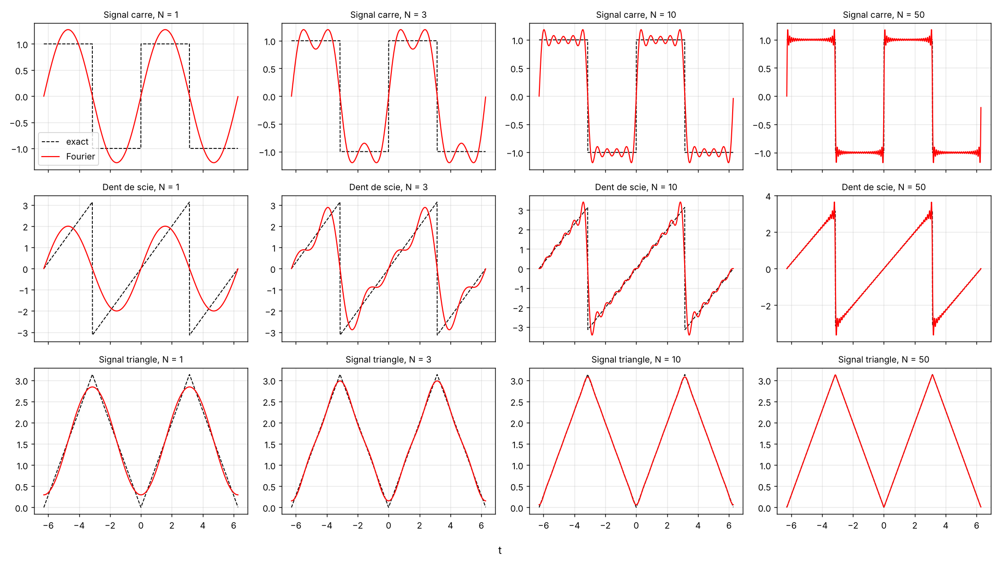

# Séries de Fourier en C

Ce projet est un petit programme en C que j'ai fait pour mon projet d'études à l'USTHB (3e année, Génie informatique). Il calcule les coefficients de Fourier d'un signal périodique et reconstruit le signal avec un nombre N d'harmoniques, pour voir comment l'approximation s'améliore quand N augmente.

## Ce que fait le programme

On choisit un signal parmi trois :

1. signal carré
2. dent de scie
3. signal triangle

Puis on choisit le nombre d'harmoniques N. Le programme :

1. calcule a0, an et bn par intégration numérique (méthode du point milieu) sur [-π, π]
2. affiche les coefficients dans le terminal
3. reconstruit le signal avec la série
4. écrit le signal exact et l'approximation dans un fichier `fourier.csv`

Les signaux sont de période 2π et la série utilisée est :

f(t) ≈ a0/2 + somme de n=1 à N de (an cos(nt) + bn sin(nt))

avec

- a0 = (1/π) ∫ f(t) dt
- an = (1/π) ∫ f(t) cos(nt) dt
- bn = (1/π) ∫ f(t) sin(nt) dt

les intégrales étant prises sur [-π, π].

## Compiler et lancer

```
gcc fourier.c -o fourier -lm
./fourier
```

Le `-lm` sert à lier la bibliothèque math (sin, cos, fmod).

Exemple pour un signal carré avec 10 harmoniques : on tape `1` puis `10`.

## Tracer les courbes

Avec gnuplot :

```
gnuplot -p -e "set datafile separator ','; plot 'fourier.csv' using 1:2 with lines title 'exact', '' using 1:3 with lines title 'Fourier'"
```

On peut aussi ouvrir `fourier.csv` dans Excel ou LibreOffice et faire un graphique avec les colonnes 2 et 3.

## Résultats

L'image `courbes.png` montre les trois signaux avec N = 1, 3, 10 et 50. En pointillé le signal exact, en rouge l'approximation.



## Ce que j'ai observé

- Plus N est grand, plus la courbe rouge colle au signal exact.
- Le triangle converge très vite, avec 10 harmoniques on ne voit presque plus de différence. Ses coefficients décroissent en 1/n².
- Le carré et la dent de scie convergent plus lentement, car leurs coefficients décroissent seulement en 1/n.
- Près des sauts, il reste un dépassement d'environ 9 % qui ne disparaît pas même avec N grand. C'est le phénomène de Gibbs. On le voit bien sur le signal carré pour N = 50.
- Pour le signal carré, les coefficients an et les bn pairs sont nuls (signal impair avec symétrie demi-onde), et les bn impairs valent 4/(nπ). Le programme retrouve bien ces valeurs, par exemple b1 = 1.273240.

## Limites

- Les intégrales sont calculées numériquement avec 20000 points, donc il y a une petite erreur de calcul (très faible).
- N est limité à 200 dans le code (constante `NMAX`).
- Seulement trois signaux pour l'instant. Pour en ajouter un, il suffit de modifier la fonction `signal`.

## Fichiers

- `fourier.c` : le code source
- `fourier.csv` : exemple de sortie (signal carré, N = 10)
- `courbes.png` : comparaison des trois signaux pour plusieurs valeurs de N

## Auteur

Chihab, étudiant en Génie informatique à l'USTHB.
